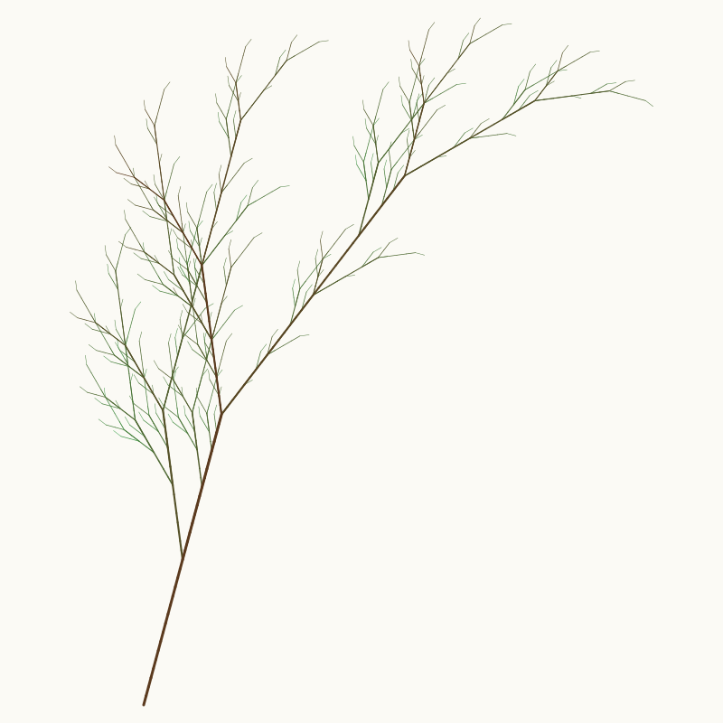
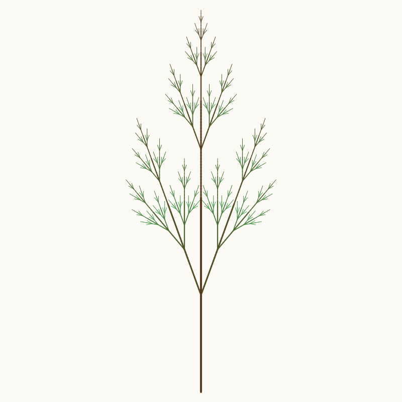
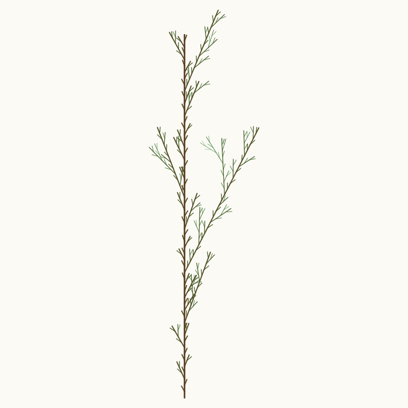

# L-System Plants

Grow fractal plants from tiny grammars. An **L-system** (Lindenmayer system) starts from an *axiom* string, rewrites every symbol in parallel using production rules, and then hands the result to a **turtle** that draws it. A few characters of grammar become a fern, a bush, or a tree. Output is a standalone SVG. The project is pure Python with no runtime dependencies.

| fern | tree | random-shrub |
|---|---|---|
|  |  |  |

## CS concepts demonstrated

- **Formal grammars and parallel rewriting**: unlike Chomsky grammars, L-systems rewrite *all* symbols at once (`AB` with `A→B, B→A` becomes `BA`, not `AA`).
- **Exponential growth**: string length grows geometrically with each iteration. Lindenmayer's algae system produces Fibonacci lengths. The generator has a `max_length` guard so a large iteration count can't use up all memory.
- **Stack-based interpretation**: `[` and `]` push and pop turtle state, so a flat string can encode a branching tree. This is the same idea as a recursive-descent call stack. Branch depth sets the colour, which fades from trunk brown to leaf green.
- **Stochastic grammars**: a rule can have several weighted successors. A seeded RNG makes every plant reproducible, and changing the seed grows a new one.
- **Validation up front**: unbalanced brackets and bad weights are rejected when the grammar is built, before anything is drawn.
- **Geometry**: heading/step vectors computed with trig, a bounding box, and a fit-to-canvas transform with the y-axis flipped for SVG.

## Layout

```
src/lsystem/
  grammar.py   LSystem class: parallel rewriting, stochastic rules, rule parser
  turtle.py    turtle interpreter → line segments (with branch depth + width)
  render.py    segments → SVG with depth-based colour gradient
  presets.py   classic grammars from "The Algorithmic Beauty of Plants"
  cli.py       command-line interface
tests/         pytest suite (grammar, turtle, rendering, CLI)
```

## Build, run, test

Requires Python 3.10+.

```bash
make test                                   # or: python3 -m pytest
PYTHONPATH=src python3 -m lsystem --list    # show presets
PYTHONPATH=src python3 -m lsystem fern -o fern.svg
make examples                               # regenerate examples/*.svg

pip install -e .                            # optional: installs the `lsystem` command
```

## Example usage

```console
$ lsystem --list
fern           Fractal fern (ABOP 1.24f)
bush           Bushy plant (ABOP 1.24d)
weed           Edge-rewritten weed (ABOP 1.24a)
tree           Node-rewritten tree with shrinking branches (ABOP 1.24e)
random-shrub   Stochastic shrub - each run with a new seed grows a different plant

$ lsystem tree --stats
iterations: 6
length:     5335
segments:   1330
...

$ lsystem random-shrub --seed 7 -o shrub7.svg
wrote shrub7.svg (… segments)

# Your own grammar (Koch-style curve), including a stochastic rule:
$ lsystem --axiom F --rule "F=F+F-F-F+F" -a 90 -n 3 -o koch.svg
$ lsystem --axiom X --rule "X=F[+X][-X]FX" --rule "F=0.6:FF|0.4:F" -a 25 -n 6 -o mine.svg
```

From Python:

```python
from lsystem import LSystem, TurtleConfig, interpret, to_svg

plant = LSystem("X", {"X": "F[+X][-X]FX", "F": "FF"})
svg = to_svg(interpret(plant.generate(6), TurtleConfig(angle=25.7)))
```

### Turtle alphabet

| Symbol | Meaning |
|---|---|
| `F`, `G` | move forward and draw |
| `f` | move forward without drawing |
| `+` / `-` | turn left / right by the angle |
| `\|` | turn around |
| `[` / `]` | push / pop state (start / end a branch) |
| `!` | shrink line width |
| anything else | ignored by the turtle (e.g. `X`, used only for rewriting) |

## Possible extensions

- Context-sensitive rules (`A<B>C → …`) for signal propagation along a stem
- Parametric L-systems (`F(l) → F(l*0.8)`) for continuous branch lengths
- 3D turtle (pitch/roll with `& ^ \ /`) rendered with matplotlib or WebGL
- Animate growth by rendering each iteration as a frame
- Leaves and flowers as filled polygons (`{ … }` in ABOP notation)
- A Tkinter or browser UI with live sliders for angle and iterations
